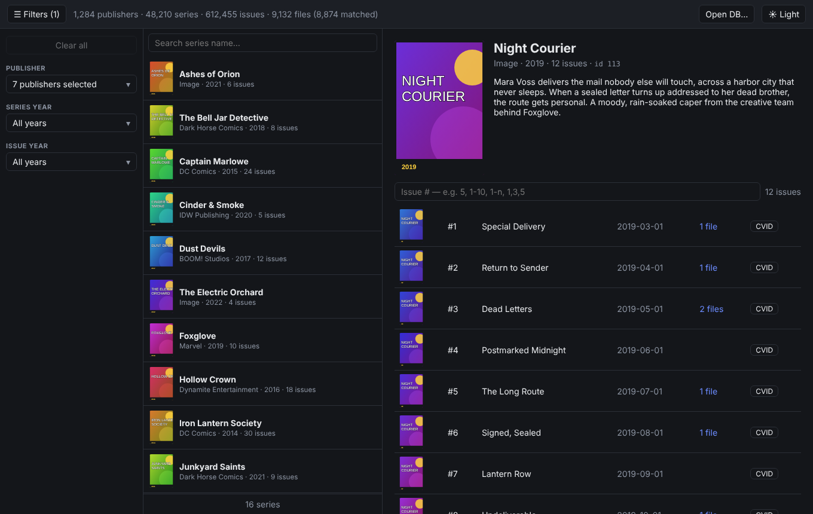
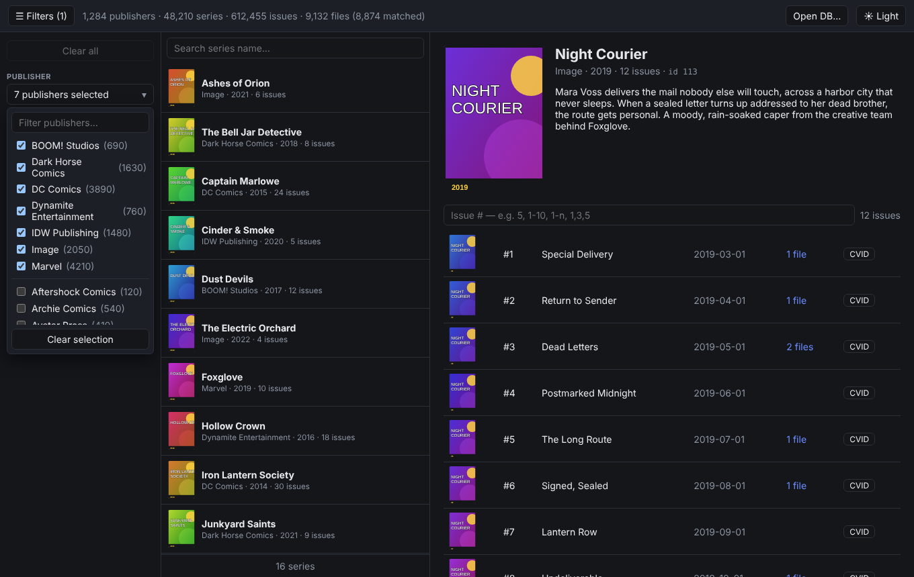
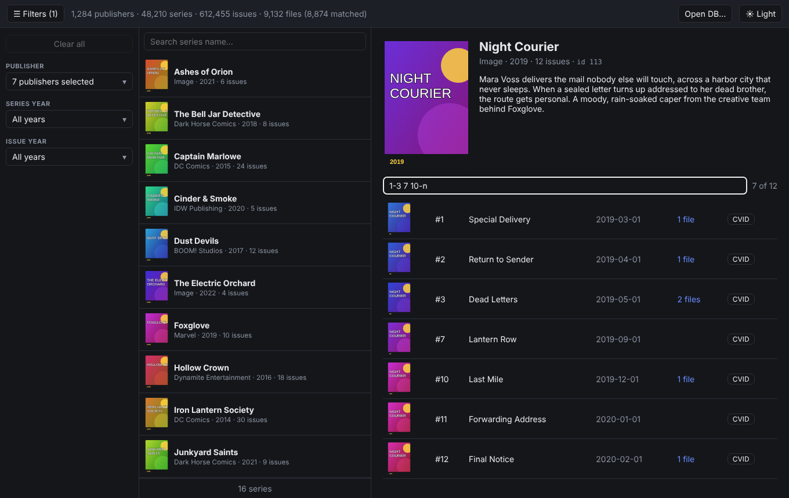
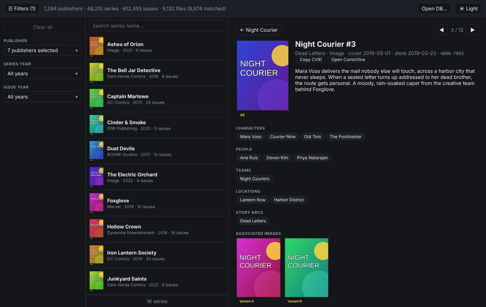
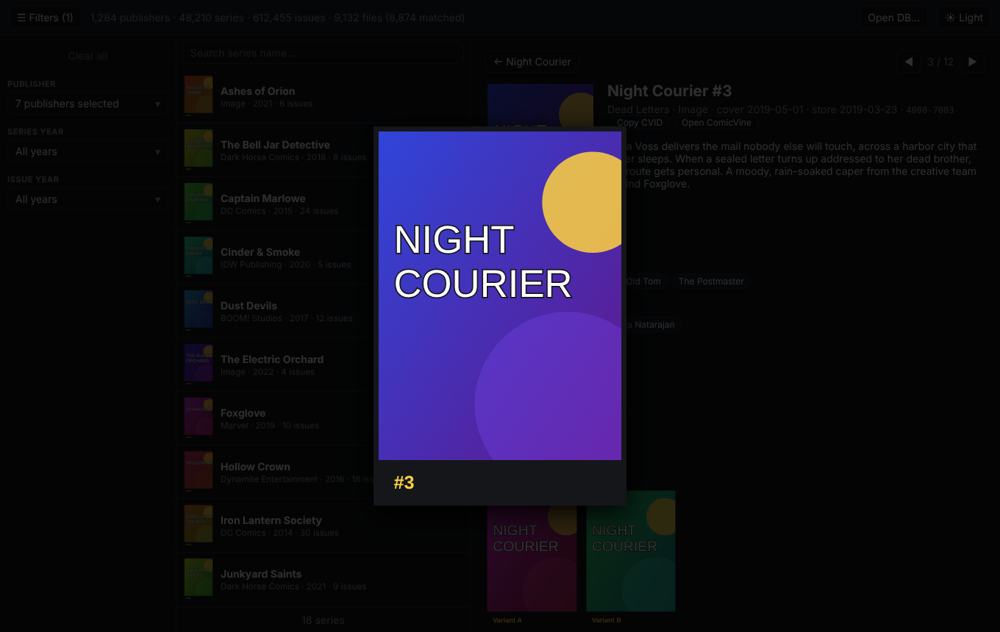
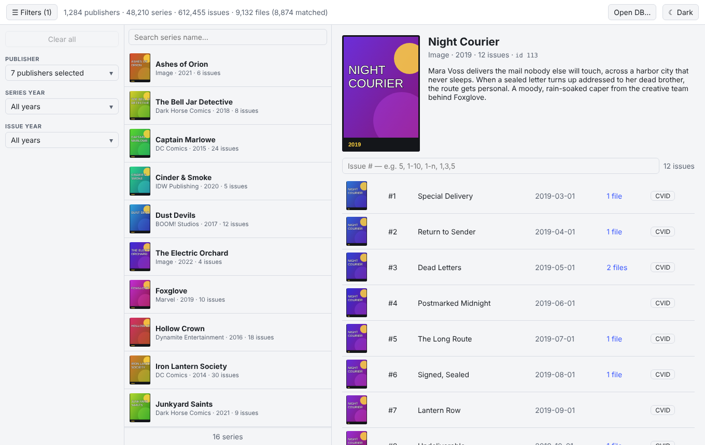

# CV Explorer

A desktop app for browsing a local [ComicVine](https://comicvine.gamespot.com/) cache stored in a SQLite database. Search series, filter by publisher and year, drill into issues, and copy CVIDs, all without touching the data: the database is opened **read-only**.

Built with [Tauri v2](https://tauri.app/) (Rust backend, plain HTML/CSS/JavaScript frontend). Runs on Windows, macOS and Linux.



*Screenshots show sample data, not a real library.*

## Features

### Opening a database
- On first launch the app shows a standard file dialog to choose your database (`.db`, `.sqlite`, `.sqlite3`).
- The chosen path is saved and opened automatically on later launches. If the saved file is missing or won't open, the dialog appears again.
- **Open DB…** in the header switches to another database and makes it the new default. A file that fails to open shows an error and leaves the current database loaded.
- The header shows totals for the open database: publishers, series, issues, files, and how many files are matched to an issue.
- **YOU MUST SUPPLY YOUR OWN COPY OF THE CV DB**

### Series list
- Search box matches the **series name**. Every word you type must appear in the name, in any order.
- Results are always sorted A to Z, ignoring case and a leading "a", "an" or "the" ("The Avengers" sorts under A).
- Shows up to **500** series. If more match, a note under the list says so; narrow the search or add filters to reach the rest.
- Each row shows a cover thumbnail, publisher, start year and issue count.

### Filter panel
A left-hand panel, shown or hidden with the **☰ Filters** button in the header (your choice is remembered; the button shows how many filter groups are in use). Filters combine with each other and with the search box.
- **Publisher**: multi-select. BOOM! Studios, Dark Horse, DC, Dynamite, IDW, Image and Marvel are pinned at the top, then a divider, then all other publishers A to Z. A filter box narrows the list. The 300 publishers with the most series are loaded.
- **Series Year**: multi-select on the series' start year.
- **Issue Year**: multi-select on the year of an issue's cover date; matches series with at least one issue from that year.
- **Only the pinned publishers are selected at startup.** **Clear all** resets the panel to that default: pinned publishers selected, both year filters empty. Each dropdown also has its own **Clear selection** button, which deselects everything in that dropdown and empties its filter box.



### Series page
- Cover, name, publisher, start year, issue count, aliases and description.
- Issue list with a cover thumbnail, issue number, title, cover date and the number of local files linked to the issue.
- **Issue-number filter** above the list:
  - a single number: `5`
  - a range with a hyphen: `1-10`, or `1-n` for "1 through the last issue"
  - `n` alone: the last issue
  - several terms separated by commas or spaces: `1,3,5` or `1-3 7 12-n`
  - decimals (`1.5`) and text (`annual`) also work
- A **CVID** button on every row copies that issue's CVID.



### Issue page
- Cover, title, series, publisher, cover and store dates, description.
- Credits shown as tags: characters, people, teams, locations and story arcs.
- Associated images, when the database has them.
- **CVID** shown in Comic Vine format (`4000-<id>`) with a **Copy CVID** button.
- **Open ComicVine** opens the issue's Comic Vine page in your default browser (it uses the stored `site_detail_url`, or builds the standard issue URL).
- **◀ / ▶** buttons, or the left and right arrow keys, step to the previous or next issue of the series. A counter shows your position (for example `3 / 12`).



### Images
Click any thumbnail or cover to open a larger version in a pop-up. The app tries the original-size image first and falls back to the one it has. Click anywhere or press Esc to close.



### Themes
Light and dark themes, switched with the toggle in the header. Until you choose one, the app follows your operating system's light or dark setting.



## Running from source

Prerequisites: [Rust](https://rustup.rs), Node.js (LTS), and the [Tauri system dependencies](https://v2.tauri.app/start/prerequisites/) for your platform.

```
npm install
npm run tauri dev
```

The first build compiles all Rust dependencies and takes several minutes. To make installers for your current platform:

```
npm run tauri build
```

They are written to `src-tauri/target/release/bundle/`.

## Where settings are stored
- **Database path:** `settings.json` in the app config folder, for example `%APPDATA%\com.local.cvexplorer\` on Windows, `~/Library/Application Support/com.local.cvexplorer/` on macOS and `~/.config/com.local.cvexplorer/` on Linux.
- **Theme and filter-panel visibility:** the webview's local storage.

## Project layout
```
src/                 frontend (index.html, main.js, style.css)
src-tauri/src/       Rust backend: SQLite queries and settings (lib.rs)
src-tauri/icons/     app icons (icon.svg is the editable source)
src-tauri/tauri.conf.json   app and bundle configuration
.github/workflows/   build and release workflows
```
